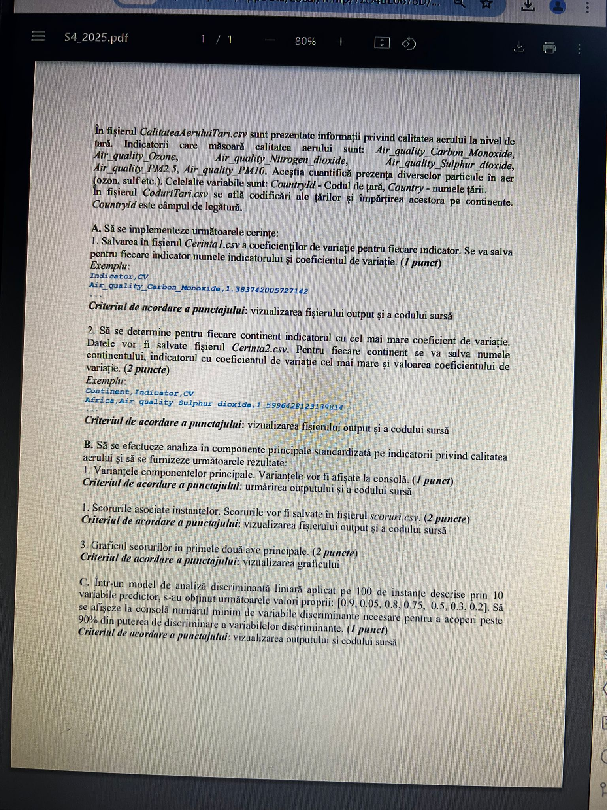
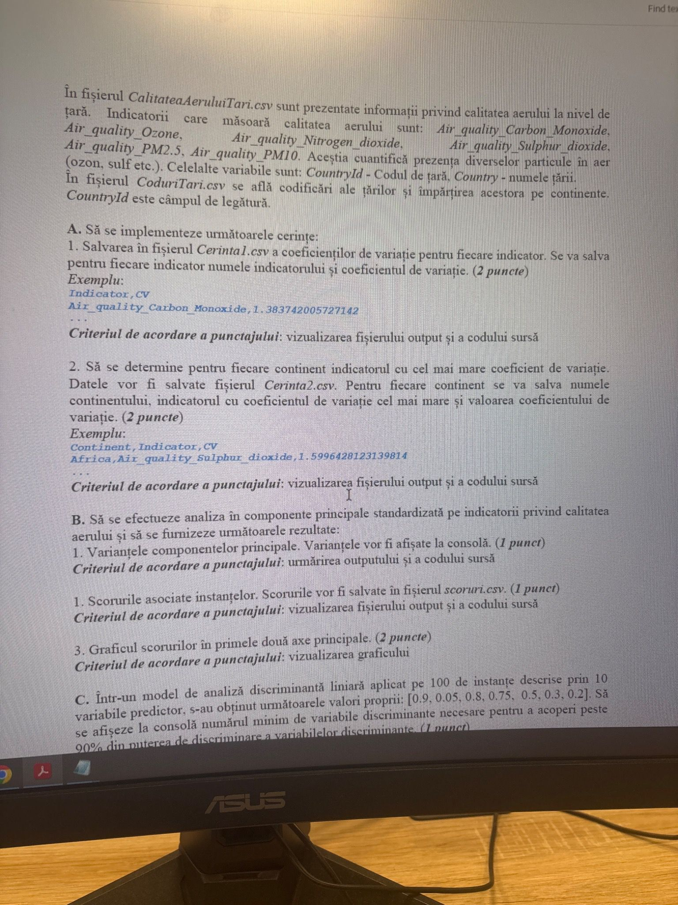

# Calitatea aerului – varianta 1 (ACP) · S4_2025




**Date (lipsesc):** `CalitateaAeruluiTari.csv` – `CountryId`, `Country` și indicatorii `Air_quality_Carbon_Monoxide`, `Air_quality_Ozone`, `Air_quality_Nitrogen_dioxide`, `Air_quality_Sulphur_dioxide`, `Air_quality_PM2.5`, `Air_quality_PM10`.
`CoduriTari.csv` – codificări + continente. Cheia: `CountryId`.

## Cerințe (transcrise din poze)

**A1.** Coeficienții de variație pentru fiecare indicator → `Cerinta1.csv`: indicator, CV. *(1p, în altă variantă 2p)*
```
Indicator,CV
Air_quality_Carbon_Monoxide,1.383742005727142
```

**A2.** Pentru fiecare continent, **indicatorul cu cel mai mare coeficient de variație** → `Cerinta2.csv`: continent, indicator, CV. *(2p)*
```
Continent,Indicator,CV
Africa,Air_quality_Sulphur_dioxide,1.5996428123139814
```

**B.** ACP standardizată: 1. varianțele componentelor la consolă *(1p)*; 2. scorurile → `scoruri.csv` *(2p / 1p)*; 3. graficul scorurilor în primele două axe *(2p)*.

**C.** LDA pe 100 de instanțe și 10 predictori, valori proprii [0.9, 0.05, 0.8, 0.75, 0.5, 0.3, 0.2]. Numărul minim de variabile discriminante pentru a acoperi peste 90% din puterea de discriminare. *(1p)* → **rezolvat: [rezolvare_C.py](rezolvare_C.py) (răspuns: 5)**

## Idei de rezolvare A
- CV = abaterea standard / medie. Pe **coloane** → `df[ind].std() / df[ind].mean()` (axis=0 e implicit).
- Atenție: pandas `.std()` are `ddof=1`, numpy `np.std` are `ddof=0`. Exemplul subiectului decide care (verifică pe date).
- A2: `groupby("Continent").apply(lambda t: t.std() / t.mean())` → pe rând `idxmax(axis=1)` și `max(axis=1)`.
