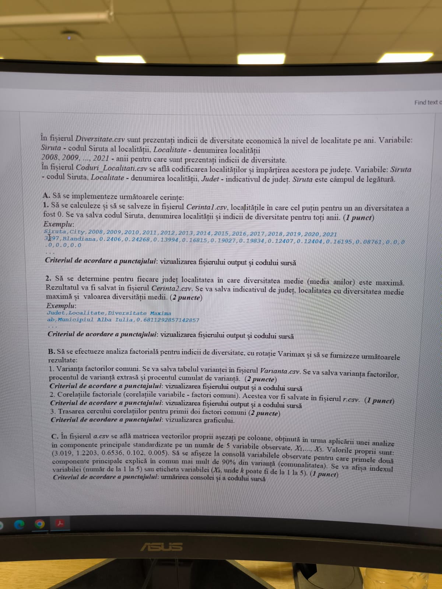

# Diversitate economică – varianta 1 (analiză factorială)



**Date (lipsesc):** `Diversitate.csv` – indicii de diversitate economică pe localități și ani: `Siruta`, `Localitate`, `2008`, `2009`, ..., `2021`.
`Coduri_Localitati.csv` – `Siruta`, `Localitate`, `Judet`. Cheia de legătură: `Siruta`.

## Cerințe (transcrise din poză)

**A1.** Localitățile în care **cel puțin pentru un an** diversitatea a fost 0 → `Cerinta1.csv`. Siruta, denumirea, indicii pe toți anii. *(1p)*
```
Siruta,City,2008,2009,2010,2011,2012,2013,2014,2015,2016,2017,2018,2019,2020,2021
3197,Blandiana,0.2406,0.24268,0.13994,0.16815,0.19027,0.19834,0.12407,0.12404,0.16195,0.08761,0.0,0.0,0.0,0.0
```

**A2.** Pentru fiecare județ, **localitatea cu diversitatea medie (media anilor) maximă** → `Cerinta2.csv`: județ, localitate, valoarea medie. *(2p)*
```
Judet,Localitate,Diversitate Maxima
ab,Municipiul Alba Iulia,0.6811292857142857
```

**B.** Analiză factorială cu rotație Varimax: 1. varianța factorilor comuni → `Varianta.csv` (varianță, procent, procent cumulat) *(2p)*; 2. corelațiile factoriale (variabile – factori comuni) → `r.csv` *(1p)*; 3. cercul corelațiilor pentru primii doi factori *(2p)*.

**C.** În `a.csv` e matricea vectorilor proprii (pe coloane) dintr-o ACP standardizată pe 5 variabile X1..X5. Valorile proprii: (3.019, 1.2203, 0.6536, 0.102, 0.005). Afișați variabilele pentru care **primele două componente explică împreună peste 90% din varianță (comunalitatea)**. *(1p)*

> Idee C: corelațiile variabile–componente `r = a * sqrt(alpha)`; comunalitatea pe primele 2 = `r[:,0]**2 + r[:,1]**2`; afișezi variabilele cu valoare > 0.9.

## Idei de rezolvare A
- A1: `df[(df[ani] == 0).any(axis=1)]`
- A2: `media = df[ani].mean(axis=1)` → merge cu `Judet` → pe fiecare județ, `idxmax` pe medie → localitatea + valoarea
