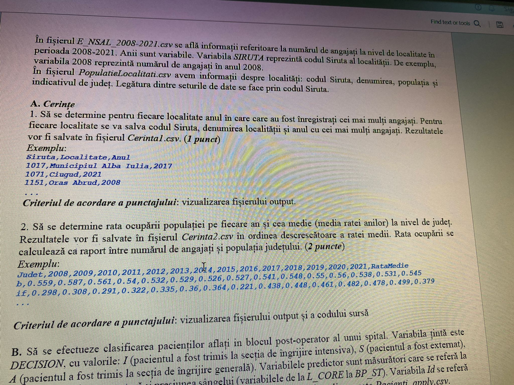
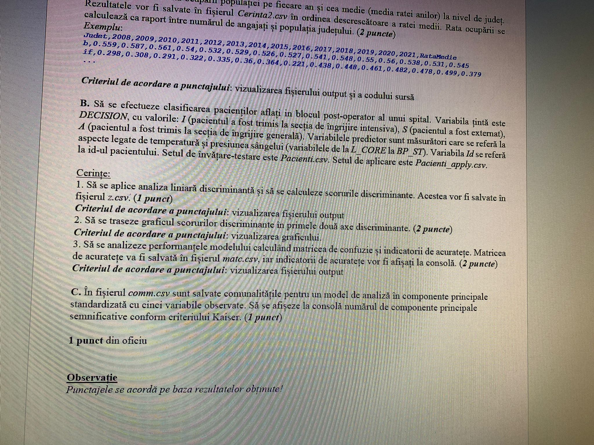

# Număr de salariați 2008–2021 (LDA)




**Date (lipsesc):** `E_NSAL_2008-2021.csv` – numărul de angajați pe localitate, 2008–2021; `SIRUTA` = codul localității, coloanele `2008`...`2021` = angajații din anul respectiv.
`PopulatieLocalitati.csv` – `Siruta`, denumire, populație, indicativ de județ. Cheia: Siruta.

## Cerințe (transcrise din poze)

**A1.** Pentru fiecare localitate, **anul cu cei mai mulți angajați** → `Cerinta1.csv`: Siruta, localitate, anul. *(1p)*
```
Siruta,Localitate,Anul
1017,Municipiul Alba Iulia,2017
1071,Ciugud,2021
1151,Oras Abrud,2008
```

**A2.** **Rata ocupării** pe fiecare an și rata medie (media ratelor anuale) la nivel de județ, descrescător după rata medie. Rata = angajați / populația județului → `Cerinta2.csv`. *(2p)*
```
Judet,2008,2009,...,2021,RataMedie
b,0.559,0.587,0.561,0.54,0.532,0.529,0.526,0.527,0.541,0.548,0.55,0.56,0.538,0.531,0.545
if,0.298,0.308,0.291,0.322,0.335,0.36,0.364,0.221,0.438,0.448,0.461,0.482,0.478,0.499,0.379
```

**B.** Clasificarea pacienților din blocul post-operator (LDA). Variabila țintă `DECISION`: I (terapie intensivă), S (externat), A (îngrijire generală). Predictori: de la `L_CORE` la `BP_ST`. Set de învățare-testare `Pacienti.csv`, set de aplicare `Pacienti_apply.csv`. 1. LDA + scorurile discriminante → `z.csv` *(1p)*; 2. graficul scorurilor în primele două axe discriminante *(2p)*; 3. matricea de confuzie → `matc.csv` + indicatorii de acuratețe la consolă *(2p)*.

**C.** În `comm.csv` sunt comunalitățile unei ACP standardizate cu 5 variabile. Afișați numărul de componente semnificative după criteriul Kaiser. *(1p)*

## Idei de rezolvare A
- A1: `df[ani].idxmax(axis=1)` (ca ramura dominantă din S2_2024)
- A2: merge cu județul + populația → `groupby("Judet").sum()` pe ani și pe populație → `df_jud[ani].div(df_jud["Populatie"], axis=0)` → `RataMedie = mean(axis=1)` → `sort_values`
